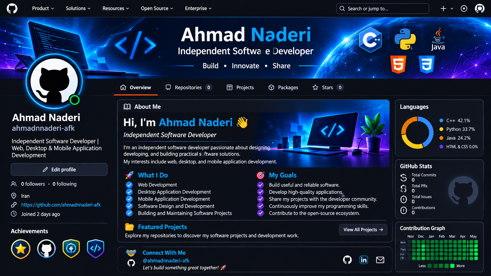

 

# Hi, I'm Ahmad Naderi 👋

### Independent Software Developer

**Build • Innovate • Share**

*Designing and developing practical software solutions.*

---

### 👨‍💻 About Me

I'm an independent software developer passionate about designing, developing, and building useful software solutions.

I enjoy exploring different areas of software development and turning ideas into practical applications.

My interests include:

- Web Development
- Desktop Application Development
- Mobile Application Development
- Software Design and Development

### 💻 Programming Languages & Technologies

  
  
  
  
  

### 🚀 What I Do

- Develop web applications.
- Build desktop software.
- Explore mobile application development.
- Design and implement software solutions.
- Build, improve, and maintain software projects.

### 🎯 My Goals

- Build useful, reliable, and high-quality software.
- Create applications that solve real-world problems.
- Continuously learn and improve my development skills.
- Share my work with the developer community.
- Contribute to open-source projects.

### 📂 Featured Projects

I'm continuously working on software projects and exploring new ideas.

Feel free to explore my repositories to see my work, experiments, and development journey.

### 🤝 Connect With Me

- **GitHub:** [@ahmadnnaderi-afk](https://github.com/ahmadnnaderi-afk)

---

⭐ **Thanks for visiting my GitHub profile!**

